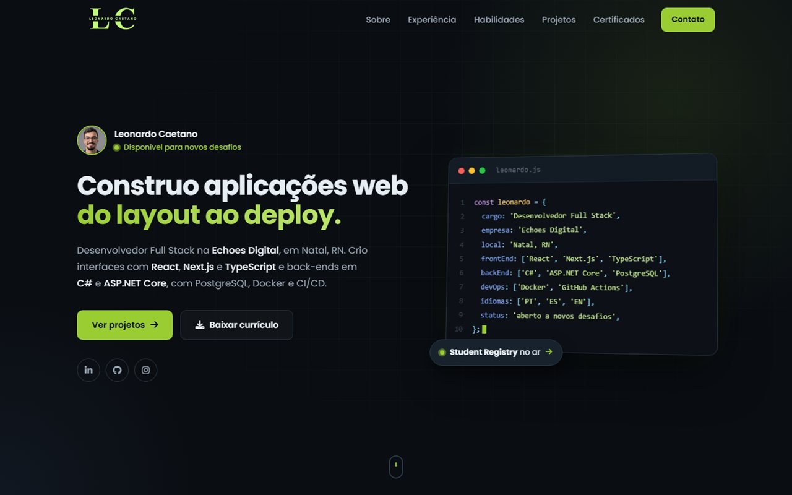

# Leonardo Caetano · Portfólio

Meu portfólio pessoal: quem sou, minha trajetória, a stack que uso, os projetos que construí e os cursos que fiz. É um site estático, leve e responsivo, publicado no GitHub Pages.

**🔗 Acesse: [leocaetano7.github.io/Leonardodev](https://leocaetano7.github.io/Leonardodev/)**

[](https://leocaetano7.github.io/Leonardodev/)

## Seções

| Seção | O que mostra |
| --- | --- |
| **Início** | Apresentação, janela de código com meu resumo e botão para baixar o currículo |
| **Sobre** | Minha história com a programação, formação, idiomas e onde trabalho hoje |
| **Experiência** | Linha do tempo da minha trajetória profissional |
| **Habilidades** | Stack de front-end, back-end e DevOps |
| **Projetos** | Projetos com captura de tela, tecnologias, link do site e do código |
| **Certificados** | Carrossel com os certificados e lista dos outros cursos |
| **Contato** | E-mail, LinkedIn e currículo |

## Funcionalidades

- Janela de código animada, que mostra o resumo linha por linha
- Linha do tempo de experiência que destaca o emprego atual
- Carrossel 3D de certificados com troca automática, setas, teclado e arrastar no celular; o certificado do centro abre a página de validação
- Menu que marca a seção visível e barra de progresso de leitura no topo
- Elementos que surgem conforme a página rola
- Botão para copiar o e-mail e currículo em PDF para download
- Layout responsivo, do celular ao desktop
- Imagens otimizadas: o site inteiro tem menos de 2 MB

## Tecnologias

- **HTML5** semântico, com atributos de acessibilidade
- **CSS3**: variáveis, Grid, Flexbox, `:has()`, `position: sticky` e animações com `@keyframes`
- **JavaScript** puro, sem frameworks: `IntersectionObserver`, Clipboard API e eventos de ponteiro
- [Font Awesome](https://fontawesome.com/) para os ícones e [Google Fonts](https://fonts.google.com/) (Poppins e JetBrains Mono)
- **GitHub Pages** para a hospedagem

## Estrutura

```
├── index.html                       # conteúdo de todas as seções
├── style.css                        # estilos, organizados por seção
├── script.js                        # menu, animações, carrossel e copiar e-mail
├── curriculo-leonardo-caetano.pdf
└── img/
    ├── certificados/                # imagens dos certificados
    └── projetos/                    # capturas dos projetos
```

## Como rodar localmente

O site não precisa de instalação nem de build:

```bash
git clone https://github.com/leocaetano7/Leonardodev.git
cd Leonardodev
```

Depois, é só abrir o `index.html` no navegador. Se usar o VS Code, a extensão **Live Server** recarrega a página a cada alteração.

## Projetos em destaque

- [**Student Registry**](https://github.com/leocaetano7/student-registry): gerenciamento de estudantes em ASP.NET Core, com PostgreSQL, Docker e CI/CD
- [**Tamanco**](https://github.com/leocaetano7/Tamanco): loja de roupas em Next.js, TypeScript, Prisma e PostgreSQL
- [**RME Manutenção Industrial**](https://github.com/leocaetano7/RME): site institucional feito como programador da empresa
- [**Additive**](https://github.com/leocaetano7/Additive): site institucional para uma empreiteira

## Contato

- E-mail: [Leo_caetanok7@outlook.com](mailto:Leo_caetanok7@outlook.com)
- LinkedIn: [Leonardo Caetano](https://www.linkedin.com/in/leonardo-caetano-05400a226/)
- GitHub: [@leocaetano7](https://github.com/leocaetano7)
